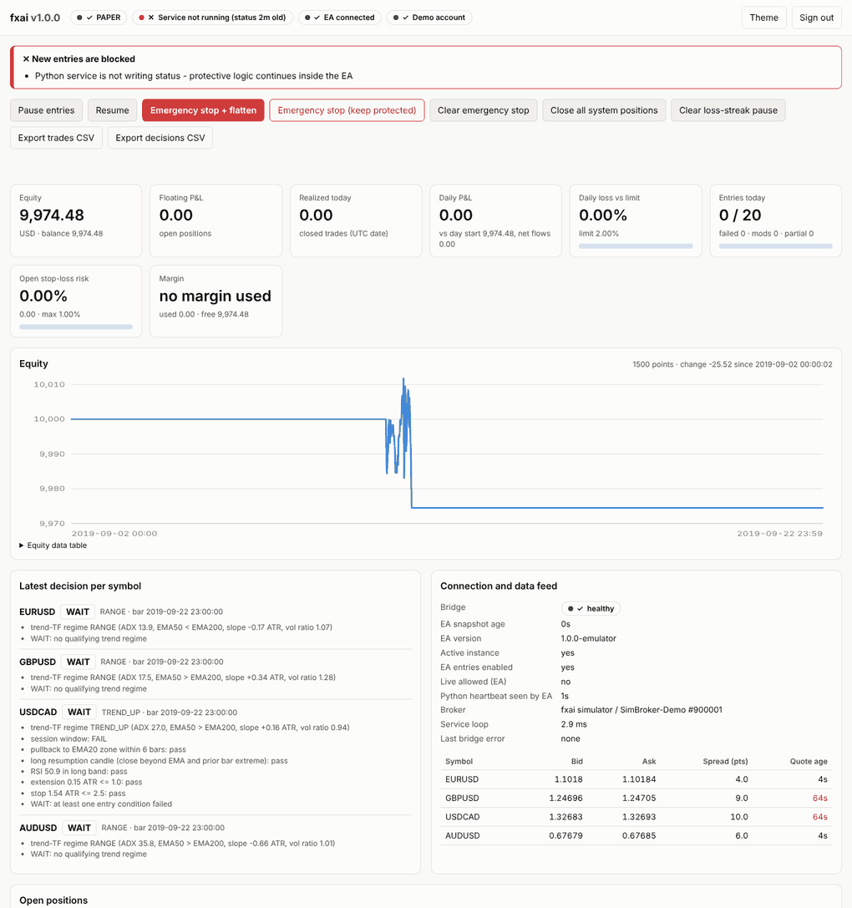

# fxai: risk-first, AI-assisted FX trading system for MetaTrader 4

An autonomous trading stack for MT4 that monitors the market about once a second, decides
BUY / SELL / WAIT on completed bars, and executes only through a deterministic risk engine
and an independent final risk gate inside the MT4 Expert Advisor.

> **Read this first.**
> - **No edge has been demonstrated.** The baseline strategy and the ML filter were evaluated
>   on 5.4 years of real 1-minute data (EURUSD, GBPUSD, USDCAD, AUDUSD) with a pre-declared
>   protocol. Both strategy variants lost money in development and in the untouched holdout,
>   even with all costs set to zero. See [docs/VALIDATION.md](docs/VALIDATION.md) and
>   [docs/RESEARCH_LOG.md](docs/RESEARCH_LOG.md).
> - The system therefore ships **demo-only**. Live trading needs several explicit switches
>   (see [docs/DEMO_AND_LIVE.md](docs/DEMO_AND_LIVE.md)) and a recorded passing validation.
> - There is no promise of profit, win rate or "experience". Losses can exceed planned stop
>   amounts because of gaps, slippage and execution failures.
> - The MQL4 EA could **not be compiled** in the environment it was written in (no MetaEditor).
>   Follow [docs/VERIFICATION.md](docs/VERIFICATION.md) before relying on it.

## What is in the box

| Component | Path | What it does |
|---|---|---|
| MT4 Expert Advisor | `mql4/Experts/FXAI_Bridge.mq4` | Exports state, quotes and bars; executes commands after its own hard risk checks; keeps broker-side SL, break-even, trailing, max-hold, daily-loss halt and persistent emergency stop running without Python; single-instance lock; never touches manual trades |
| History export script | `mql4/Scripts/FXAI_ExportHistory.mq4` | Exports your broker's bars to CSV for backtesting |
| Python service | `fxai/service.py` | 1-second monitoring loop; decisions on completed bars; reconciliation; safety actions |
| Strategy (baseline) | `fxai/strategy/trend_pullback.py` | Small, explainable trend-regime + pullback-entry rules with per-rule reasons |
| Risk engine | `fxai/risk/` | Sizing from tick value/size/lot step, per-trade/total/currency/correlation limits, margin, spread, stale quotes, cooldowns, loss streaks, daily loss with deposit handling, emergency stop |
| Execution | `fxai/execution/`, `fxai/bridge/` | File protocol, idempotent commands, ambiguous-outcome reconciliation (never blind-retries), trade tracking |
| ML meta-filter (optional) | `fxai/ml/` | Logistic regression, purged walk-forward, calibration check, JSON model files, human approval gate. **Currently not approvable** (failed its gates). |
| LLM review (optional, off) | `fxai/llm/` | Bounded Claude review of a candidate: structured JSON, can only veto, cached, timed out, budget-capped |
| Economic calendar | `fxai/news/` | CSV feed you supply; inactive (and shown as inactive) if none |
| Dashboard | `fxai/dashboard/` | Status, P&L (realised and floating), risk, decisions with reasons, logs, controls, exports; password + CSRF; secrets never sent to the browser |
| Backtester | `fxai/backtest/` | Same strategy and risk code as live; M1 fills; spread, commission, swap and slippage; stop-first rule for intrabar ambiguity; validation report generator |
| Storage | `fxai/storage.py` | SQLite (WAL): signals, decisions, commands, trades, events, equity, risk state, controls, audit, models, LLM calls |

Screenshot of the dashboard (paper session on 2019 data):



## Status: implemented vs. tested vs. simulated vs. unavailable

| Item | Status |
|---|---|
| Python service, risk engine, order manager, storage, dashboard, CLI | Implemented and unit/integration tested (`reports/test_output.txt`) |
| File protocol end to end (service, bridge, files, EA emulator, simulated broker) | Tested with the Python EA emulator. The real MQL4 EA has **not** run against it yet |
| MQL4 EA | Written; static consistency checks pass (`tests/test_ea_source.py`); **not compiled, not run in MT4** |
| Backtests / walk-forward | Run on real Oanda M1 data, 2015-01 to 2020-05, 4 pairs; results in `reports/validation/` |
| USDJPY, USDCHF, NZDUSD | Supported in code; **no historical data was available here**, so they are not backtested |
| Spreads in backtests | **Modelled** (mid-price data has no bid/ask); assumptions in `fxai/backtest/costs.py` |
| Paper trading | Implemented (`python -m fxai paper`); historical replay through the real service and bridge code |
| Broker connectivity, demo forward test | **Not done**: needs your MT4 terminal and demo account |
| News feed | No feed bundled. CSV loader implemented; inactive by default |
| LLM review | Implemented and tested with a fake client; **no live API call was made**; off by default |

## Quick start (demo)

Full instructions: [docs/INSTALL_WINDOWS_VPS.md](docs/INSTALL_WINDOWS_VPS.md).

```powershell
# Windows, in the fx-ai-trader folder
py -3.13 -m venv .venv                                  # tested with Python 3.13
.venv\Scripts\pip install -r requirements.txt
copy config\config.example.yaml config\config.yaml      # edit symbols suffix etc.
copy config\.env.example .env
.venv\Scripts\python -m fxai hash-password              # put the output in .env
.venv\Scripts\python -m fxai gen-secret                 # put the output in .env
# MT4: copy mql4\Experts\FXAI_Bridge.mq4 to <MT4 data folder>\MQL4\Experts, compile, attach to ONE chart
.venv\Scripts\python -m fxai service                    # terminal 1
.venv\Scripts\python -m fxai dashboard                  # terminal 2, then open http://127.0.0.1:8787
```

The EA ships with `EnableTrading=false`. Start that way to verify connectivity, then enable
it on a **demo** account.

## Tests and reproducibility

```bash
pip install -r requirements-dev.txt
python -m pytest                       # 140 tests: risk, sizing, time/DST, strategy causality, fills,
                                       # protocol, integration, dashboard security, LLM bounds, ML gates
python -m fxai validate --data-root <oanda folder>    # regenerates reports/validation/<ts>/REPORT.md
```

`scripts/fetch_oanda_data.sh` downloads the public dataset that was used.

## Documentation

- [ARCHITECTURE.md](docs/ARCHITECTURE.md): components, data flow, why a file bridge, failure handling
- [PROTOCOL.md](docs/PROTOCOL.md): MT4 to Python file protocol specification
- [RISK.md](docs/RISK.md): every risk control, the sizing formula, daily-loss calculation, policies and limitations
- [STRATEGY.md](docs/STRATEGY.md): baseline rules and how decisions are explained
- [MODEL_CARD.md](docs/MODEL_CARD.md): ML meta-filter dataset, features, labels, validation, limitations; LLM design
- [VALIDATION.md](docs/VALIDATION.md): measured results, including losing periods
- [RESEARCH_LOG.md](docs/RESEARCH_LOG.md): every evaluation in order, so the amount of testing is visible
- [INSTALL_WINDOWS_VPS.md](docs/INSTALL_WINDOWS_VPS.md): installation and VPS deployment
- [DEMO_AND_LIVE.md](docs/DEMO_AND_LIVE.md): demo forward-test procedure and the explicit live-enable checklist
- [VERIFICATION.md](docs/VERIFICATION.md): what was and was not verified, and the exact remaining steps
- [TROUBLESHOOTING.md](docs/TROUBLESHOOTING.md)
- [SERVICES_AND_COSTS.md](docs/SERVICES_AND_COSTS.md): external services, licences, subscriptions and costs

## Licence and data

The code in this folder is provided as-is for your own use. The validation data
(Oanda candles mirrored by FutureSharks/financial-data) is **not** redistributed here; the fetch
script downloads it from the public mirror. Check the data provider's terms before using it.
This is not investment advice.
