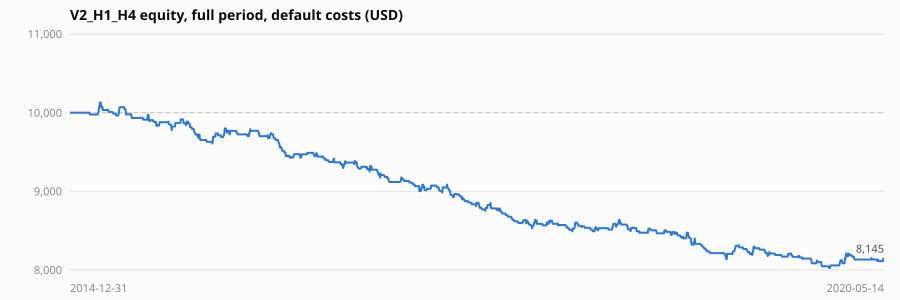
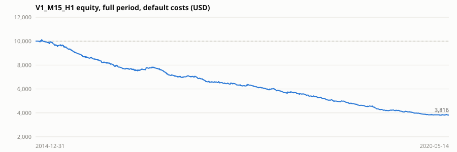

# Validation report (20261020T185546Z)

> **Historical simulation only.** These numbers come from a simulator applied to past data with the cost assumptions listed below. They are not live results, they do not predict future performance, and the strategy has **not** shown a positive edge on this data.

- Data: Oanda M1 mid prices, public mirror github.com/FutureSharks/financial-data (2015-2020, data ends 2020-05-14)
- Symbols: AUDUSD, EURUSD, GBPUSD, USDCAD
- Initial balance 10,000 USD; default risk settings (0.25 %/trade, 1 % total, 3 positions, 2 % daily loss, 20 entries/day); same `RiskEngine` code as live.
- Costs: {"EURUSD": 0.5, "GBPUSD": 0.9, "AUDUSD": 0.6, "USDCAD": 0.9, "USDJPY": 0.5, "USDCHF": 0.9, "NZDUSD": 1.2} pips base spread (x session multipliers), commission 7.0 USD/lot round turn, entry slippage 0.1 pip, stop/forced-exit slippage 0.3 pip, swap -0.3 pip/night (triple Wednesday).
- Fills: M1 bars; when one M1 bar touches both stop and target the stop is assumed first; gaps fill at the open; break-even/trailing take effect from the next bar.

## V2_H1_H4 (H1 entries / H4 trend) - 699 baseline signals

| Run | Trades | Net % | Max DD % | PF | Win % | Exp. R | Exp. $/trade | Exposure % | Costs $ | Losing months |
|---|---|---|---|---|---|---|---|---|---|---|
| dev_2015_2017 | 311 | -13.7 | 15.4 | 0.64 | 32.8 | -0.199 | -4.40 | 10.5 | 539 | 28/35 |
| holdout_2018_2020 | 227 | -5.5 | 7.8 | 0.80 | 33.5 | -0.102 | -2.42 | 11.8 | 529 | 18/29 |
| full_period | 538 | -18.6 | 21.0 | 0.70 | 33.1 | -0.158 | -3.45 | 11.1 | 993 | 47/64 |
| full_zero_cost | 547 | -5.7 | 10.0 | 0.91 | 48.6 | -0.046 | -1.04 | 11.1 | 0 | 36/64 |

**Cost sensitivity (full period):**

| Run | Trades | Net % | Max DD % | PF | Win % | Exp. R | Exp. $/trade | Exposure % | Costs $ | Losing months |
|---|---|---|---|---|---|---|---|---|---|---|
| spread x1.5 | 537 | -19.1 | 21.4 | 0.69 | 32.6 | -0.167 | -3.55 | 11.2 | 1,170 | 45/64 |
| spread x2 | 528 | -19.6 | 22.0 | 0.69 | 32.0 | -0.173 | -3.71 | 11.4 | 1,292 | 47/64 |
| slippage x2 | 536 | -19.1 | 21.5 | 0.70 | 23.7 | -0.165 | -3.57 | 11.0 | 1,169 | 45/64 |
| commission x1.5 | 536 | -20.1 | 22.2 | 0.68 | 23.3 | -0.174 | -3.74 | 10.9 | 1,177 | 46/64 |
| swap x2 | 538 | -19.0 | 21.4 | 0.69 | 33.1 | -0.164 | -3.52 | 11.1 | 1,047 | 47/64 |

Yearly net (full period, USD): {'2015': -311.01, '2016': -414.53, '2017': -641.5, '2018': -172.16, '2019': -414.87, '2020': 99.38}
Worst month -224.1 USD, best month 130.85 USD, max consecutive losses 17, daily-loss halts 0.
Exit reasons: {'sl': 276, 'breakeven': 114, 'tp': 104, 'time': 28, 'sl_gap': 10, 'breakeven_gap': 6}. Bars with stop/target ambiguity: 0 (in 0 trades).
Risk-engine rejections (full period): {'one_position_per_symbol': 129, 'currency_exposure': 36, 'consecutive_loss_pause': 17, 'loss_cooldown': 3, 'max_open_positions': 1}

**ML meta-filter, chronological walk-forward (6-month folds from 2016-07, purged, embargo 72 h):**

- OOS rows 513, AUC 0.4841, Brier 0.23319 vs base-rate Brier 0.22383 (skill -0.0418), folds with positive skill 0.25, max calibration error 0.1709 (NOT calibrated).
- Per-signal expectancy (R, net): unfiltered -0.1462, filtered -0.1852 (260 of 513 taken).
- Approval gates: {'enough_data': True, 'brier_skill_positive': False, 'brier_skill_positive_in_60pct_folds': False, 'filtered_expectancy_positive': False, 'filtered_beats_unfiltered': False} -> **NOT approvable**.

Portfolio comparison on the same out-of-sample period:

| Run | Trades | Net % | Max DD % | PF | Win % | Exp. R | Exp. $/trade | Exposure % | Costs $ | Losing months |
|---|---|---|---|---|---|---|---|---|---|---|
| baseline OOS | 392 | -14.2 | 15.8 | 0.69 | 32.9 | -0.160 | -3.62 | 11.6 | 809 | 36/47 |
| ML-filtered OOS | 214 | -8.4 | 11.2 | 0.68 | 34.6 | -0.173 | -3.95 | 5.5 | 471 | 28/45 |

## V1_M15_H1 (M15 entries / H1 trend) - 3009 baseline signals

| Run | Trades | Net % | Max DD % | PF | Win % | Exp. R | Exp. $/trade | Exposure % | Costs $ | Losing months |
|---|---|---|---|---|---|---|---|---|---|---|
| dev_2015_2017 | 1030 | -40.0 | 40.9 | 0.63 | 33.9 | -0.207 | -3.89 | 16.4 | 2,469 | 31/36 |
| holdout_2018_2020 | 825 | -37.4 | 38.4 | 0.58 | 32.7 | -0.233 | -4.54 | 15.9 | 2,594 | 24/29 |
| full_period | 1855 | -61.8 | 62.5 | 0.61 | 33.4 | -0.219 | -3.33 | 16.2 | 4,007 | 55/65 |
| full_zero_cost | 1932 | -23.8 | 29.6 | 0.87 | 48.1 | -0.056 | -1.23 | 16.2 | 0 | 37/65 |

**Cost sensitivity (full period):**

| Run | Trades | Net % | Max DD % | PF | Win % | Exp. R | Exp. $/trade | Exposure % | Costs $ | Losing months |
|---|---|---|---|---|---|---|---|---|---|---|
| spread x1.5 | 1686 | -63.6 | 64.1 | 0.58 | 31.7 | -0.251 | -3.77 | 16.1 | 4,023 | 55/65 |
| spread x2 | 1446 | -57.2 | 58.0 | 0.57 | 31.5 | -0.246 | -3.96 | 15.4 | 3,788 | 54/65 |
| slippage x2 | 1810 | -65.2 | 65.8 | 0.59 | 19.9 | -0.243 | -3.60 | 15.9 | 4,478 | 58/65 |
| commission x1.5 | 1810 | -65.2 | 65.9 | 0.58 | 20.2 | -0.243 | -3.60 | 15.8 | 4,491 | 56/65 |
| swap x2 | 1855 | -62.9 | 63.5 | 0.61 | 33.4 | -0.225 | -3.39 | 16.2 | 4,120 | 55/65 |

Yearly net (full period, USD): {'2015': -1958.07, '2016': -995.42, '2017': -1051.95, '2018': -1017.57, '2019': -1035.66, '2020': -125.38}
Worst month -309.15 USD, best month 134.62 USD, max consecutive losses 19, daily-loss halts 0.
Exit reasons: {'sl': 954, 'breakeven': 412, 'tp': 350, 'sl_gap': 67, 'time': 42, 'breakeven_gap': 30}. Bars with stop/target ambiguity: 1 (in 1 trades).
Risk-engine rejections (full period): {'reentry_cooldown': 207, 'one_position_per_symbol': 857, 'currency_exposure': 176, 'consecutive_loss_pause': 157, 'loss_cooldown': 92, 'spread_to_stop': 72, 'max_open_positions': 7}

**ML meta-filter, chronological walk-forward (6-month folds from 2016-07, purged, embargo 72 h):**

- OOS rows 2206, AUC 0.5746, Brier 0.22188 vs base-rate Brier 0.22325 (skill 0.0061), folds with positive skill 0.625, max calibration error 0.0861 (calibrated).
- Per-signal expectancy (R, net): unfiltered -0.2297, filtered -0.1875 (1065 of 2206 taken).
- Approval gates: {'enough_data': True, 'brier_skill_positive': True, 'brier_skill_positive_in_60pct_folds': True, 'filtered_expectancy_positive': False, 'filtered_beats_unfiltered': True} -> **NOT approvable**.

Portfolio comparison on the same out-of-sample period:

| Run | Trades | Net % | Max DD % | PF | Win % | Exp. R | Exp. $/trade | Exposure % | Costs $ | Losing months |
|---|---|---|---|---|---|---|---|---|---|---|
| baseline OOS | 1333 | -51.6 | 52.5 | 0.59 | 33.1 | -0.225 | -3.87 | 15.8 | 3,552 | 40/47 |
| ML-filtered OOS | 718 | -26.4 | 28.2 | 0.68 | 38.7 | -0.174 | -3.68 | 5.2 | 2,389 | 36/47 |

## Parameter sensitivity (V2, full period - information only, not used to select anything)

| Run | Trades | Net % | Max DD % | PF | Win % | Exp. R | Exp. $/trade | Exposure % | Costs $ | Losing months |
|---|---|---|---|---|---|---|---|---|---|---|
| TP 1.5R | 541 | -18.9 | 21.6 | 0.69 | 37.1 | -0.160 | -3.49 | 10.0 | 978 | 46/64 |
| TP 3R | 533 | -17.6 | 20.4 | 0.71 | 30.4 | -0.153 | -3.30 | 13.3 | 1,028 | 42/64 |
| break-even off | 529 | -17.3 | 19.5 | 0.77 | 32.7 | -0.150 | -3.27 | 14.0 | 1,008 | 44/64 |
| trailing on | 537 | -17.7 | 20.3 | 0.71 | 35.9 | -0.150 | -3.29 | 10.4 | 990 | 46/64 |
| ADX min 25 | 449 | -16.4 | 18.7 | 0.69 | 33.0 | -0.166 | -3.64 | 9.4 | 849 | 44/63 |
| room filter off | 1130 | -21.7 | 22.7 | 0.82 | 34.2 | -0.092 | -1.92 | 24.8 | 1,904 | 42/64 |

## Reading this report

- `dev_2015_2017` was used for the pre-declared variant selection; `holdout_2018_2020` was not used for any decision. `full_zero_cost` removes all costs to show the gross edge of the rules.
- Exposure = share of time with at least one open position. Expectancy R is net P&L divided by the risk engine's planned risk per trade.
- Realised losses can exceed planned stop risk (gaps, slippage); see `sl_gap` exits.
